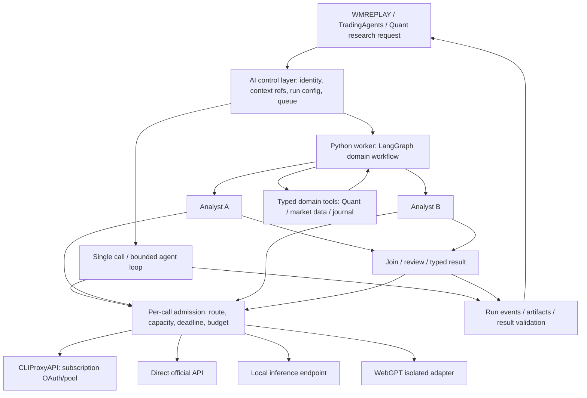

# Nền AI chung cho TradingWorkspace

Ngày khảo sát: 23/10/2026. Phạm vi: WMREPLAY, TradingAgents và Quant Lab;
tooling agent phục vụ phát triển được xét để tránh trùng chức năng.
Đây là khuyến nghị kiến trúc từ source và tài liệu upstream, không phải execution
plan, benchmark, acceptance ledger hoặc quyền gọi provider/broker. Không thay đổi
trạng thái trong CURRENT-CONTEXT hay các product plan.

## Kết luận

Reuse LangGraph đang có trong TradingAgents làm lựa chọn đầu tiên cho workflow
nhiều agent/phụ thuộc nhiều bước. Giữ Rust/Axum cho API tương tác và kiểm quyền;
giữ Quant Lab làm lõi tính toán kiểm chứng. Bổ sung control layer AI dùng chung
theo contract, không rewrite ba repo thành một framework hoặc gộp database.

Single-call tasks có thể chạy trực tiếp qua adapter trong backend; complex runs
được giao cho worker Python/LangGraph. Cả hai dùng cùng admission policy cho từng
model call. Dùng library upstream và adapter nhỏ trước khi fork framework.
Chưa có benchmark chứng minh stack này là nhanh nhất; đây là lựa chọn phù hợp nhất
về reuse/ownership trong phạm vi khảo sát, cần xác nhận bằng pilot.

Tài liệu [WMREPLAY AI platform](../../projects/mt5-tradingview-backtester/foundation_v2/docs/AI-PLATFORM-ARCHITECTURE.md)
vẫn giữ thiết kế sản phẩm. Việc xét Rig đầu tiên ở đó là ưu tiên cho SDK Rust;
scope liên project hiện tại ưu tiên reuse LangGraph cho complex workflow vì đã có
consumer thật. Không suy ra cần thêm Rig vào đường chạy có LangGraph.

## Bằng chứng local

| Nguồn | Quan sát | Hệ quả |
| --- | --- | --- |
| `projects/TradingAgents/tradingagents/graph/setup.py:95-154` | StateGraph; analyst nối tuần tự, debate theo điều kiện | Không thể coi multi-agent hiện có là parallel; chỉ tách nhánh sau kiểm tra dependency/state reducer |
| `projects/TradingAgents/tradingagents/graph/trading_graph.py:184-198` | Quick/deep dùng chung `llm_provider`, backend URL và kwargs | Chưa có route provider/model/effort riêng cho từng role |
| `projects/TradingAgents/tradingagents/dataflows/config.py:6-37` | Mutable config toàn process | Nguy cơ lẫn data config giữa concurrent runs; tạm dùng process isolation, đích là config theo run |
| `projects/TradingAgents/tradingagents/graph/checkpointer.py` | SQLite checkpointer theo ticker | Reuse resume behavior; cần run identity/isolation trước concurrent same-ticker jobs |
| `projects/quant-trading/pyproject.toml`, README, AGENTS | Numeric research độc lập, causal timing/cost/OOS, chưa có LLM dependency | Không biến accounting/backtest thành agent; expose typed tool/result ở boundary |
| `projects/mt5-tradingview-backtester/foundation_v2/api-rust/src/ai_assistant.rs:15-16` | Một ChatTurn và provider chung trong RAM | Chưa là platform concurrent/durable; đổi default không được đổi route của run đang chạy |
| `tooling/run_registry/README.md` | Offline run lineage, fencing và journal, không supervisor/live | Reuse correlation/provenance semantics; không biến registry thành scheduler hoặc authority thứ hai |
| `tooling/agent-workflow/README.md` | CLI dev worker/reviewer trong staging, một invocation một lúc | Giữ riêng dev automation; không dùng CLI có quyền code làm product AI runtime |

Đã đọc source/docs, không gọi inference, OAuth, dữ liệu holdout hoặc đặt lệnh.
Không chạy lại regression tests vì chưa sửa implementation. Các nhận xét concurrency
là rủi ro từ source, chưa phải lỗi race đã được tái hiện bằng runtime.

## Luồng đích

Mũi tên tới provider thể hiện model call; response quay về đúng caller.
Sơ đồ là logical modules, không yêu cầu một daemon cho mỗi ô. Control layer có
thể bắt đầu trong API Rust hiện có, nhưng contract độc lập UI và không để Python
import backend Rust hoặc chia sẻ trực tiếp bảng nghiệp vụ. Worker có boundary
process rõ và vòng đời được quản lý; chưa cài/chạy thêm service trong lượt này.

Control layer own run identity, admission, model-profile version và trạng thái
public. LangGraph own node state/checkpoint của workflow; project own dữ liệu,
domain rule và artifact gốc. Correlation ID nối chúng; không có hai bộ logic tự
retry cùng một step. Run registry offline chỉ nhận projection khi phù hợp.

## Tách các chiều cấu hình

- Connection: credentials/endpoint, health và quota khi quan sát được; không lộ
  OAuth tokens cho agent. Subscription không đồng nghĩa quota API vô hạn.
- Model capability: model ID và route cụ thể, tools/schema/vision/streaming,
  context/output limits, reasoning options thực sự được endpoint hỗ trợ.
- Profile: vai trò như extraction, analysis, critical-review; map tới model,
  native effort, timeout, token budget và fallback được cho phép. Fast/strong là
  policy theo task đã đo, không phải thang chất lượng phổ quát.
- Agent: instructions/context/tools/permissions/output schema và profile.
- Workflow: graph dependencies, parallel branches, joins, retries, deadlines,
  maximum agent depth/steps. Không cần LLM dispatcher cho một rule xác định.
- Run: snapshot bất biến của các version/config trên, cutoff và input refs.
  Model discovery chỉ phát hiện candidate; không tự promote model mới giữa run.

Không map `high` giữa các hãng như cùng một mức tính toán; UI chỉ hiện option
được route hỗ trợ. Ghi requested và effective route/effort khi có thể xác minh;
nếu gateway không báo thì ghi unknown, không đoán model nền từ alias.
Fallback khác model/context/tools hoặc chất lượng cần policy rõ; không âm thầm
hạ critical-review sang model nhanh hoặc chuyển sang kênh tính phí.

## Reuse và lựa chọn upstream

| Thành phần | Vai trò phù hợp | Khuyến nghị |
| --- | --- | --- |
| LangGraph | Stateful graph, branches/joins, persistence, human checkpoints | Ưu tiên complex worker vì TradingAgents đã dùng; reuse upstream package, custom domain nodes/contracts |
| PydanticAI | Typed agents/tools/output, delegation khác model, usage limits | Challenger cho feature mới nếu pilot cho thấy giảm complexity đáng kể; chưa thêm agent runtime thứ hai |
| Google ADK | Agent teams, parallel workflow, provider integrations | Có năng lực phù hợp; chưa có lý do migrate workflow đang có chỉ vì ưu tiên Gemini |
| Microsoft Agent Framework | Multi-provider agents, harness, explicit workflows | Candidate có sẵn; migration/.NET or Python footprint phải đem lại lợi ích thật; không thêm chỉ để gom agent |
| CrewAI | Role/task crews, event-driven flows | Hợp tổ chức team nhanh, nhưng hiện trùng LangGraph; chưa có lợi thế đo được cho repo |
| Rig library | Rust provider/tool/agent primitives | Chỉ đánh giá khi native single-agent path thiếu SDK; library khác terminal coding harness, không mặc định cài CLI |
| CLIProxyAPI | Compatible provider APIs, subscription authentication/account routing | Giữ pinned upstream như transport đã chọn; không fork hoặc coi là workflow engine |
| LiteLLM | Unified provider gateway, routing/rate limits/budgets/usage | Chỉ thêm khi đa consumer/direct APIs cần vận hành chung; tránh thêm gateway nối tầng trước khi có nhu cầu đo được |

Không có project upstream nào tự mang đầy đủ chart cutoff, Quant causal timing,
broker permissions và workflow sản phẩm này. Phần custom cần tập trung vào đó,
không tự viết lại model clients, graph engine hoặc OAuth flow đã có.

License survey: LangGraph, PydanticAI, CLIProxyAPI có MIT ở upstream đã xem;
LiteLLM phần ngoài enterprise có MIT, enterprise có điều khoản riêng. Chưa audit
dependency tree/install scripts hoặc chọn version cho deployment mới. Không coi
bảng này là supply-chain approval để cài toàn bộ các framework.

## Hiệu năng và độ tin cậy

1. Chỉ parallel nhánh độc lập; dữ liệu đầu vào immutable, output slot riêng,
   reducer/join rõ. Reviewer nhận evidence gốc, không chỉ bản tóm tắt của worker.
2. Giới hạn toàn máy/provider/model/account/project và parent-run budget bao gồm
   subagents; reserve capacity cho interactive, không để research chiếm hết.
   Gateway own account rotation, control layer own workflow concurrency; tránh
   cả hai tự xoay/retry vô hạn. Quota không biết thì bound bảo thủ, đo 429/cooldown.
3. Event-driven, debounce và gộp yêu cầu cùng revision; cancel/supersede context
   cũ. Không gọi model mỗi tick và không giữ DB transaction trong lúc inference.
4. Persistent state/checkpoints đúng backend; stream/reconnect đọc lại event
   không phát lại inference. Timeout có external effect chưa rõ cần reconcile;
   checkpoint/retry không bảo đảm exactly-once cho lệnh broker.
5. Process/resource isolation cho Python numerical jobs/local inference; đo UI
   frame time, chart/MT5 latency, RAM/GPU cùng p50/p95 queue/first token/completion.
6. Trace theo feature/run/node/model/config/input hash; redaction mặc định, không
   lưu secret hoặc full broker data vào external telemetry. Model chi phí và
   subscription quota có thể không có cùng đơn vị; không giả số tiền bằng 0.

LLM giải thích, trích xuất, đề xuất và review. Numeric code own giá trị tính toán,
costs/risk/backtest. Execution service own broker command và kiểm quyền lại lúc
thực thi. Chất lượng model cao không tự cấp quyền giao dịch.

## Pilot cần có trước khi promote

- Một typed extraction/summarization đơn, một TradingAgents branch/join thực sự
  parallel, một Quant tool call với fixture cutoff cố định; thêm cancellation và
  concurrent same-symbol/different-config cases.
- Đối chiếu baseline trên cùng input, model routes/effort và resource cap. Report
  correctness/schema/tool success, causal fidelity, latency/tokens/quota/RAM và
  ảnh hưởng chart. Dùng serial baseline để biết parallel có lợi thật không.
- Test provider capabilities tại endpoint thật: tools, schema, stream, effort,
  error/cooldown/cancel. Text chat chạy được không chứng minh agent tools chạy được.
- Crash/restart/checkpoint replay, stale result, unknown provider outcome và
  permission denied. Backend admission phải bao gồm mọi child call.
- Chỉ nâng model/framework sau eval và rollback được; không tự upgrade production
  bằng danh sách model mới lấy từ gateway. Chưa đề xuất Redis/Kafka/Temporal/K8s
  khi chưa thấy giới hạn từ workload thực.

## Primary sources

- [LangGraph overview](https://docs.langchain.com/oss/python/langgraph/overview),
  [persistence](https://docs.langchain.com/oss/python/langgraph/persistence),
  [multi-agent patterns](https://docs.langchain.com/oss/python/langchain/multi-agent),
  [license](https://github.com/langchain-ai/langgraph/blob/main/LICENSE).
- [PydanticAI delegation/multiple models](https://pydantic.dev/docs/ai/guides/multi-agent-applications/),
  [license](https://github.com/pydantic/pydantic-ai/blob/main/LICENSE).
- [Google ADK parallel workflow](https://adk.dev/agents/workflow-agents/parallel-agents/).
- [Microsoft Agent Framework](https://learn.microsoft.com/en-us/agent-framework/overview/).
- [CrewAI Flows](https://docs.crewai.com/en/concepts/flows).
- [Rig upstream](https://github.com/0xPlaygrounds/rig).
- [CLIProxyAPI upstream](https://github.com/router-for-me/CLIProxyAPI).
- [LiteLLM request lifecycle](https://docs.litellm.ai/docs/proxy/architecture),
  [routing](https://docs.litellm.ai/docs/routing),
  [license boundary](https://github.com/BerriAI/litellm/blob/main/LICENSE).
