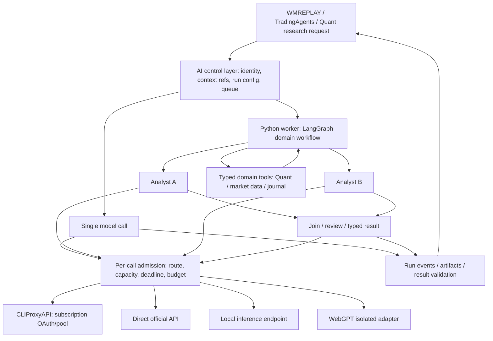

# Nền AI chung cho TradingWorkspace

Ngày khảo sát: 23/10/2026. Phạm vi: WMREPLAY, TradingAgents và Quant Lab;
tooling agent phục vụ phát triển được xét để tránh trùng chức năng.
**Revision 2 — đã review thiết kế trước triển khai.** Findings, source locations,
fixture thực chạy và giới hạn bằng chứng ở [review](ai-architecture-review-20261023/REVIEW.md).
Đây là khuyến nghị kiến trúc từ source và tài liệu upstream, không phải execution
plan, benchmark, acceptance ledger hoặc quyền gọi provider/broker. Không thay đổi
trạng thái trong CURRENT-CONTEXT hay các product plan.

## Kết luận

Chọn LangGraph đã đối chiếu upstream 0.7.0 làm ứng viên đầu tiên cho workflow
nhiều agent/phụ thuộc nhiều bước. Giữ Rust/Axum cho API tương tác và kiểm quyền;
giữ Quant Lab làm lõi tính toán kiểm chứng. Bổ sung control layer AI dùng chung
theo contract, không rewrite ba repo thành một framework hoặc gộp database.

Single-call tasks có thể chạy trực tiếp qua adapter trong backend; complex runs
được giao cho worker Python/LangGraph. Cả hai dùng cùng admission policy cho từng
model call. Dùng library upstream và adapter nhỏ trước khi fork framework.
Rust không có agent/tool loop thứ hai: hễ cần nhiều lượt model/tools hoặc subagents
thì LangGraph own vòng đó. Reuse LangGraph library, không dùng toàn bộ TradingAgents
debate graph làm harness cho mọi tính năng. Chat text hiện có giữ đường đơn giản;
chat có tools sau này dùng cùng worker runtime.
Không giữ implementation vì đã tồn tại: contract/nghiệp vụ có thể reuse, còn code
phải vượt correctness/performance gate. Fixture topology cho thấy lợi ích parallel
ở riêng analyst stage; chưa chứng minh stack này nhanh nhất. Lựa chọn dựa trên
capability và ownership, còn so sánh framework/language cần pilot cùng workload.

Tài liệu [WMREPLAY AI platform](../../projects/mt5-tradingview-backtester/foundation_v2/docs/AI-PLATFORM-ARCHITECTURE.md)
giữ thiết kế sản phẩm và được đồng bộ về cùng ownership: Rust cho API/admission,
LangGraph cho complex workflow. Rig là challenger khi benchmark cho thấy lợi ích;
không thêm agent SDK thứ hai vào iteration đầu.

## Baseline local trước khi nâng TradingAgents

| Nguồn | Quan sát | Hệ quả |
| --- | --- | --- |
| `projects/TradingAgents/tradingagents/graph/setup.py:95-154` | StateGraph; analyst nối tuần tự, debate theo điều kiện | Không thể coi multi-agent hiện có là parallel; chỉ tách nhánh sau kiểm tra dependency/state reducer |
| `projects/TradingAgents/tradingagents/graph/trading_graph.py:184-198` | Quick/deep dùng chung `llm_provider`, backend URL và kwargs | Chưa có route provider/model/effort riêng cho từng role |
| `projects/TradingAgents/tradingagents/dataflows/config.py:6-37` | Mutable config toàn process | Nguy cơ lẫn data config giữa concurrent runs; tạm dùng process isolation, đích là config theo run |
| `projects/TradingAgents/tradingagents/graph/checkpointer.py` + `_run_signature` trong `trading_graph.py` | SQLite theo ticker; thread hash có ngày, graph/portfolio/model-route signature | Đã có fingerprint bảo vệ resume khác cấu hình, nhưng hai yêu cầu độc lập cùng signature vẫn cùng thread; cần run identity/isolation |
| `projects/quant-trading/pyproject.toml`, README, AGENTS | Numeric research độc lập, causal timing/cost/OOS, chưa có LLM dependency | Không biến accounting/backtest thành agent; expose typed tool/result ở boundary |
| `projects/mt5-tradingview-backtester/foundation_v2/api-rust/src/ai_assistant.rs:15-16` | Một ChatTurn và provider chung trong RAM | Chưa là platform concurrent/durable; đổi default không được đổi route của run đang chạy |
| `tooling/run_registry/README.md` | Offline run lineage, fencing và journal, không supervisor/live | Reuse correlation/provenance semantics; không biến registry thành scheduler hoặc authority thứ hai |
| `tooling/agent-workflow/README.md` | CLI dev worker/reviewer trong staging, một invocation một lúc | Giữ riêng dev automation; không dùng CLI có quyền code làm product AI runtime |

Đã đọc source/docs, không gọi inference, OAuth, dữ liệu holdout hoặc đặt lệnh.
Các dòng TradingAgents trong bảng là baseline 0.5.0, không còn là source hiện hành
sau cập nhật. Upstream/main = v0.7.0 `e8f5503`, đã fetch và hợp nhất cùng local
guards: analyst subgraphs song song với output riêng/barrier, ContextVar theo run,
provider/endpoint riêng cho quick/deep tier, tool-round cap và sửa causal timing.
Không cần custom lại những phần upstream đã giải quyết. Standalone vẫn dùng
resume theo ticker/date/settings và file roots; product integration cần namespace
run/workspace riêng. Bộ offline và giới hạn bằng chứng ở review được dẫn đầu file.

## Luồng đích

Mũi tên tới provider thể hiện model call; response quay về đúng caller.
Sơ đồ là logical modules, không yêu cầu một daemon cho mỗi ô. Control layer có
thể bắt đầu trong API Rust hiện có, nhưng contract độc lập UI và không để Python
import backend Rust hoặc chia sẻ trực tiếp bảng nghiệp vụ. Worker có boundary
process rõ và vòng đời được quản lý; chưa cài/chạy thêm service trong lượt này.

Control layer own run identity, admission, model-profile version và trạng thái
public. LangGraph own node state/checkpoint của workflow; project own dữ liệu,
domain rule và artifact gốc. Correlation ID nối chúng; không có hai bộ logic tự
retry cùng một step. Run registry offline chỉ nhận projection khi phù hợp.

## Ranh giới triển khai sau review

| Owner | Sở hữu | Không sở hữu |
| --- | --- | --- |
| API Rust hiện có | Auth, config binding, context refs, run admission/lifecycle, per-call permits, events cho UI | Agent planning/tool loop hoặc proxy chuyển mọi provider protocol |
| Worker Python/LangGraph | Agent loop, branch/join, node state/checkpoint, adapter gọi model | Tự mở quyền domain, tự thay run config hoặc tự bypass admission |
| Connection adapters/gateway | Gọi endpoint đã đăng ký, protocol/auth, credential routing trong pool | Chọn workflow, quyền tools, thay model âm thầm |
| Domain service từng project | Dữ liệu, cutoff, tính toán, tool validation, command execution | Provider selection hoặc LLM-generated arithmetic làm nguồn chuẩn |
| PostgreSQL/artifact storage | Run/config/messages/events; checkpoint schema do library own; artifacts có scoped refs/hash | Một kho memory toàn cục trộn mọi project/user |

Một API owner và worker được quản lý trên máy hiện tại là đủ; chưa tạo backend hay
repo nền mới. Product DB giữ nguyên ownership; chỉ shared contracts và AI metadata.
Worker không truy cập trực tiếp bảng nghiệp vụ của project khác. Không lấy dev CLI
runner, generic shell hoặc coding-agent harness làm tool của sản phẩm.

Per-call admission là control RPC nhỏ, không là endpoint inference proxy mới:
worker xin permit gắn run/attempt/node/route/deadline rồi dùng SDK/adapter gọi đúng
connection server đã đăng ký, renew/release và báo kết quả. Native single-call
path dùng cùng admission implementation. Gateway API key chỉ ở server/worker có
quyền, không trong prompt/UI. SDK không tự chọn endpoint hoặc retry ngoài policy.
Permit không phải sandbox chống worker đã bị chiếm quyền; đây là trusted code,
với local RPC auth riêng và tools tối thiểu. Spike phải chứng minh mọi child call
đi qua hook này trước khi công bố global resource cap.

Run lease và model-call permit khác nhau. Không giữ model permit khi parent đang
chờ tools/subagents; giữ budget reservation đúng phần đã sử dụng. Cancel làm ngừng
dispatch mới, nhưng chỉ giải phóng occupancy khi transport đã dừng hoặc outcome đã
được xử lý. Sau API crash, fencing ngăn worker cũ ghi kết quả; không lập tức tái
dispatch những call còn có thể chạy upstream. Mất lease không tự chứng minh call
đã hủy. Nếu chưa chứng minh được phép đếm xuyên restart thì phải công bố giới hạn
này, không hứa hard cap tuyệt đối ở provider.

PostgreSQL reuse run leases/fencing và claim queue hiện có ở mức pattern. Không
copy `research_jobs` recovery tự động requeue hết expired jobs cho AI/external
effects. Chuyển trạng thái và ghi durable event trong cùng transaction; SSE là
projection đọc events, không là nguồn trạng thái. LangGraph checkpoint là private
workflow state có version; Rust không tự viết/giải mã serializer nội bộ của nó.

## Tách các chiều cấu hình

- Connection: credentials/endpoint, health và quota khi quan sát được; không lộ
  OAuth tokens cho agent. Subscription không đồng nghĩa quota API vô hạn.
- Model capability: model ID và route cụ thể, tools/schema/vision/streaming,
  context/output limits, reasoning options thực sự được endpoint hỗ trợ.
- Profile: vai trò như extraction, analysis, critical-review; map tới model,
  native effort, timeout, token budget và fallback được cho phép. Fast/strong là
  policy theo task đã đo, không phải thang chất lượng phổ quát.
- Agent: instructions/context/tools/permissions/output schema và profile.
- Workflow: graph dependencies, parallel branches, joins, retries, deadlines,
  maximum agent depth/steps. Không cần LLM dispatcher cho một rule xác định.
- Run: snapshot bất biến của các version/config trên, cutoff và input refs.
  Model discovery chỉ phát hiện candidate; không tự promote model mới giữa run.

Chat lựa chọn theo conversation/subject trong workspace; credential connection là
machine-scoped và được cấp quyền sử dụng riêng. Không dùng provider/model mutable
toàn process làm config của mọi chat/tính năng. Với feature/role, precedence là
override hợp lệ của role → profile của feature → default tương thích của hệ thống.
Các phần connection/model/native options được validate như một bundle; đổi model
không giữ lại effort không tương thích. Chat có explicit selection thì giữ selection
đó; thiếu capability trả lỗi cấu hình rõ ràng, không tự đổi model.

Phân biệt conversation_id, run_id duy nhất cho mỗi yêu cầu chủ ý, input_hash,
client idempotency_key, attempt_id và node/call_id. Input giống nhau không có nghĩa
cùng một run. Retry POST cùng key trong scope trả lại run; cùng key khác payload
bị từ chối. Chat lưu lịch sử chuẩn hóa riêng và tuần tự theo conversation; hai
conversation có thể chạy song song. First worker integration dùng thread/namespace
gắn run_id cho workflow một lần; không suy resume từ ticker/date/input hash.

Không map `high` giữa các hãng như cùng một mức tính toán; UI chỉ hiện option
được route hỗ trợ. Ghi requested và effective route/effort khi có thể xác minh;
nếu gateway không báo thì ghi unknown, không đoán model nền từ alias.
Fallback khác model/context/tools hoặc chất lượng cần policy rõ; không âm thầm
hạ critical-review sang model nhanh hoặc chuyển sang kênh tính phí.

Snapshot chỉ pin requested route/config; alias `latest` hoặc upstream cập nhật vẫn
có thể đổi weights thật. Ghi resolved model/version nếu upstream cung cấp; nếu không
thì ghi unknown và không hứa tái lập bit-identical. Pool credential phải đồng nhất
logical model/capability cho một route; không trộn model khác nhau dưới cùng alias.

Capability record gắn connection + endpoint/protocol + model + revision của cấu
hình route, có nguồn asserted/verified và thời điểm kiểm. `/models` không chứng minh
tools/schema/effort hoạt động. Không tự inference chỉ để kiểm tra khi mở UI. Health
tách process/auth/catalog/last-call; model list lấy được không phải connected-ready
cho mọi tính năng. Unknown capability không được dùng cho required feature.

Đổi provider trong chat chỉ gửi lại user-visible history đã chuẩn hóa và tool
results có schema hợp lệ. Không chuyển opaque reasoning state, signed thinking
blocks hoặc provider continuation IDs sang hãng khác. Context budget phải chừa
chỗ cho tool results/output; compact có nguồn và giới hạn, không silently bỏ data
quyết định. Schema-valid output vẫn phải qua domain/evidence validation.

## Reuse và lựa chọn upstream

| Thành phần | Vai trò phù hợp | Khuyến nghị |
| --- | --- | --- |
| LangGraph | Stateful graph, branches/joins, persistence, human checkpoints | Ưu tiên complex worker vì TradingAgents đã dùng; reuse upstream package, custom domain nodes/contracts |
| PydanticAI | Typed agents/tools/output, delegation khác model, usage limits | Challenger cho feature mới nếu pilot cho thấy giảm complexity đáng kể; chưa thêm agent runtime thứ hai |
| Google ADK | Agent teams, parallel workflow, provider integrations | Có năng lực phù hợp; chưa có lý do migrate workflow đang có chỉ vì ưu tiên Gemini |
| Microsoft Agent Framework | Multi-provider agents, harness, explicit workflows | Candidate có sẵn; migration/.NET or Python footprint phải đem lại lợi ích thật; không thêm chỉ để gom agent |
| CrewAI | Role/task crews, event-driven flows | Hợp tổ chức team nhanh, nhưng hiện trùng LangGraph; chưa có lợi thế đo được cho repo |
| Rig library | Rust provider/tool/agent primitives | Chỉ đánh giá khi native single-agent path thiếu SDK; library khác terminal coding harness, không mặc định cài CLI |
| CLIProxyAPI | Compatible provider APIs, subscription authentication/account routing | Giữ pinned upstream như transport đã chọn; không fork hoặc coi là workflow engine |
| LiteLLM | Unified provider gateway, routing/rate limits/budgets/usage | Chỉ thêm khi đa consumer/direct APIs cần vận hành chung; tránh thêm gateway nối tầng trước khi có nhu cầu đo được |

Không có project upstream nào tự mang đầy đủ chart cutoff, Quant causal timing,
broker permissions và workflow sản phẩm này. Phần custom cần tập trung vào đó,
không tự viết lại model clients, graph engine hoặc OAuth flow đã có.

License survey: LangGraph, PydanticAI, CLIProxyAPI có MIT ở upstream đã xem;
LiteLLM phần ngoài enterprise có MIT, enterprise có điều khoản riêng. Chưa audit
dependency tree/install scripts hoặc chọn version cho deployment mới. Không coi
bảng này là supply-chain approval để cài toàn bộ các framework.

## Hiệu năng và độ tin cậy

1. Chỉ parallel nhánh độc lập; dữ liệu đầu vào immutable, output slot riêng,
   reducer/join rõ. Reviewer nhận evidence gốc, không chỉ bản tóm tắt của worker.
2. Giới hạn toàn máy/connection/quota-domain/model/project và parent-run budget bao
   gồm subagents; reserve capacity cho interactive, không để research chiếm hết.
   Gateway own account rotation, control layer own workflow concurrency; tránh
   cả hai tự xoay/retry vô hạn. Quota không biết thì bound bảo thủ, đo 429/cooldown.
   Không claim app cap theo account nếu gateway không expose identity/quota group
   ổn định. Nhiều credential có thể chung quota; không nhân capacity theo số file.
3. Event-driven, debounce và gộp yêu cầu cùng revision; cancel/supersede context
   cũ. Không gọi model mỗi tick và không giữ DB transaction trong lúc inference.
4. Persistent state/checkpoints đúng backend; stream/reconnect đọc lại event
   không phát lại inference. Timeout có external effect chưa rõ cần reconcile;
   checkpoint/retry không bảo đảm exactly-once cho lệnh broker.
5. Process/resource isolation cho Python numerical jobs/local inference; đo UI
   frame time, chart/MT5 latency, RAM/GPU cùng p50/p95 queue/first token/completion.
6. Warm worker pool và HTTP clients/connection pools dùng lại theo route/config
   revision; lazy-load SDK không dùng, không boot process/model mới cho từng call.
   Cache clients hữu hạn và đóng khi revoke/rotate credential; không giữ stale
   authorization. Sync I/O cần concurrency budget; CPU tasks không chạy trên
   interactive executor. Đo cả cold start và warm steady-state.
7. Trace theo feature/run/node/model/config/input hash; redaction mặc định, không
   lưu secret hoặc full broker data vào external telemetry. Model chi phí và
   subscription quota có thể không có cùng đơn vị; không giả số tiền bằng 0.

LLM giải thích, trích xuất, đề xuất và review. Numeric code own giá trị tính toán,
costs/risk/backtest. Execution service own broker command và kiểm quyền lại lúc
thực thi. Chất lượng model cao không tự cấp quyền giao dịch.

Fixture offline dùng cùng 4 production analyst subgraphs, mỗi nhánh giả lập 50ms
I/O: median 207.827ms ở concurrency1 và 56.360ms ở concurrency4, 20 mẫu xen kẽ,
output hash giống nhau. Đây là speedup3.687x của stage giả lập, không phải tốc độ
model thật/toàn app hoặc bằng chứng Python/Rust nhanh hơn nhau. [Raw samples](ai-architecture-review-20261023/topology-result.json).

Rust phù hợp đường API nhiều I/O, kiểm quyền và events; không tự bảo đảm nhanh
nhất. Rewrite CPU stage sang Rust chỉ khi đo thắng cùng semantics/inputs; numeric
Python có thể gọi native kernels. Không chặn async executor bằng compute, không
nhân worker/GPU jobs đến mức chart và broker heartbeat bị ảnh hưởng.

## Recovery, state và tools

- Agent branches có messages/tool state riêng, trả output theo role; upstream
  TradingAgents 0.7.0 đã có subgraphs/barrier đúng pattern này. Không quay lại cách
  fan-out trực tiếp shared sender/message deletion của bản 0.5.0. Join chỉ
  chạy khi đủ required branches; optional branch fail phải hiện completeness và
  warnings, không giả kết quả đầy đủ. Graph topology v1 định trước, không recursive
  agent spawning hoặc runtime-generated graphs. Reviewer dùng evidence refs gốc.
- Rust own lifecycle công khai: queued/running/waiting/cancelling và terminal;
  cancellation request khác cancelled. Mỗi model/tool attempt ghi sent/completed/
  failed/outcome_unknown theo observation. Outcome chưa rõ không tự được retry vì
  worker lease hết hạn. Retry read/model call chỉ theo policy hữu hạn; side-effect
  tool cần domain idempotency/reconciliation. Một interrupted run có thể cần người
  xử lý; không hứa tất cả tác vụ tự resume không mất inference.
- SDK retry, graph retry và gateway retry phải có owner/budget rõ. Managed gateway
  hiện đã đặt request-retry=0 và retry interval=0; giữ bounded profile. TradingAgents
  hiện để SDK default khi llm_max_retries=None; integration phải đặt explicit theo
  route để tránh khuếch đại. Preserve error class, Retry-After khi có, request ID,
  timeout phase và partial-output flag; không dùng một generic busy cho mọi lỗi.
- Domain command idempotency key gắn logical run/node/action, không attempt_id mới
  mỗi retry. Approval hoặc bot mandate gắn exact action/args hash, account, revision,
  expiry và scope; domain recheck khi execute. Prompt/tool output không cấp authority.
  Post-interrupt code vẫn có thể replay nếu crash trước checkpoint: đặt effect sau
  approval là cần nhưng chưa đủ để đảm bảo không trùng. Broker command cần receipt
  và reconciliation của domain hiện có; không qua generic research auto-retry.
- Lưu context snapshot nhỏ hoặc artifact ref có hash, cutoff và quyền/revision;
  dữ liệu bất biến không cần nhân bản vào mọi node checkpoint. LangGraph own private
  schema, public events chỉ tiến độ/kết quả chuẩn hóa. Không persist mỗi token vào
  DB; stream coalesced có buffer/window giới hạn, snapshot fallback khi reconnect.
- Giới hạn retention cho messages/events/checkpoints/artifacts; xóa conversation
  phải xử lý các bản dẫn xuất theo policy, giữ audit tối thiểu được yêu cầu riêng.
  Không tự tạo long-term cross-project memory hoặc vector DB ở iteration đầu.
  Cache chỉ pure operations, key bao gồm scope/permission revision/context/cutoff/
  template/tool schema/model route/options; không cache side effects.
- First integration dùng một graph instance cho mỗi run và namespace/data roots
  riêng để tránh cùng checkpoint/report path. Upstream 0.7.0 đã có run-scoped config;
  không cần process-per-run chỉ để né global config. Worker pool hữu hạn theo resource
  budget, không spawn process cho từng subagent. Python compute/local inference có
  budget riêng với I/O; process boundary dùng khi isolation/crash/CPU thực sự cần.

Endpoint/secret chỉ từ registered server config, không từ prompt/request tùy ý;
kiểm origin/session cho browser, worker identity/scope cho internal RPC. Loopback
không tự thay auth. Credentials chỉ quản lý ở server với ACL/secret mechanism phù
hợp, không trong graph checkpoints/logs. Không thêm generic SQL/shell tools.
Public metadata dùng vi/en; dữ liệu nguồn, prompt nội bộ và evidence giữ locale
explicit, không dịch tên model/effort hoặc thay numeric values khi render.

## Lược bỏ và thứ tự tối thiểu

Giữ một workflow runtime (LangGraph), một owner điều phối (Rust API), transport
CLIProxyAPI/WebGPT đang có và PostgreSQL hiện có. Không thêm ở iteration đầu:
Rig/PydanticAI/ADK cùng lúc, LiteLLM chồng gateway, Redis/Kafka/Temporal/K8s,
MCP/A2A cho internal function calls, agent tự tạo code/tools, Auto routing,
vector memory, visual workflow builder hoặc hệ billing/quota dự đoán phức tạp.
Không bắt mỗi feature có planner/reviewer/debate: workflow đơn dùng single call;
reviewer chỉ thêm khi cải thiện chất lượng đủ bù chi phí trên eval.

Lát đầu triển khai dọc: persistent chat runs/config theo conversation → một
read-only feature qua worker và per-call admission → một fixed parallel workflow
có Quant evidence. Official API/local routes là capability mở rộng sau, không
bắt tích hợp tất cả trước khi nhận lát đầu. WebGPT vẫn là route giới hạn/legacy;
critical workflow chỉ dùng route đủ capability đã kiểm. Subscription gateway có
thể gián đoạn độc lập source app, nên trạng thái/policy phải thể hiện giới hạn đó.

## Pilot cần có trước khi promote

- Một typed extraction/summarization đơn, một TradingAgents branch/join thực sự
  parallel, một Quant tool call với fixture cutoff cố định; thêm cancellation và
  concurrent same-symbol/different-config cases.
- Đối chiếu baseline trên cùng input, model routes/effort và resource cap. Report
  correctness/schema/tool success, causal fidelity, latency/tokens/quota/RAM và
  ảnh hưởng chart. Dùng serial baseline để biết parallel có lợi thật không.
- Test provider capabilities tại endpoint thật: tools, schema, stream, effort,
  error/cooldown/cancel. Text chat chạy được không chứng minh agent tools chạy được.
- Crash/restart/checkpoint replay, stale result, unknown provider outcome và
  permission denied. Backend admission phải bao gồm mọi child call.
- Chỉ nâng model/framework sau eval và rollback được; không tự upgrade production
  bằng danh sách model mới lấy từ gateway. Chưa đề xuất Redis/Kafka/Temporal/K8s
  khi chưa thấy giới hạn từ workload thực.

## Primary sources

- [TradingAgents v0.7.0 changelog](https://github.com/TauricResearch/TradingAgents/blob/e8f5503e9b86d5c2710b0c76b1f686703968c9df/CHANGELOG.md).
- [LangGraph overview](https://docs.langchain.com/oss/python/langgraph/overview),
  [persistence](https://docs.langchain.com/oss/python/langgraph/persistence),
  [multi-agent patterns](https://docs.langchain.com/oss/python/langchain/multi-agent),
  [license](https://github.com/langchain-ai/langgraph/blob/main/LICENSE).
- [PydanticAI delegation/multiple models](https://pydantic.dev/docs/ai/guides/multi-agent-applications/),
  [license](https://github.com/pydantic/pydantic-ai/blob/main/LICENSE).
- [Google ADK parallel workflow](https://adk.dev/agents/workflow-agents/parallel-agents/).
- [Microsoft Agent Framework](https://learn.microsoft.com/en-us/agent-framework/overview/).
- [CrewAI Flows](https://docs.crewai.com/en/concepts/flows).
- [Rig upstream](https://github.com/0xPlaygrounds/rig).
- [CLIProxyAPI upstream](https://github.com/router-for-me/CLIProxyAPI).
- [LiteLLM request lifecycle](https://docs.litellm.ai/docs/proxy/architecture),
  [routing](https://docs.litellm.ai/docs/routing),
  [license boundary](https://github.com/BerriAI/litellm/blob/main/LICENSE).
